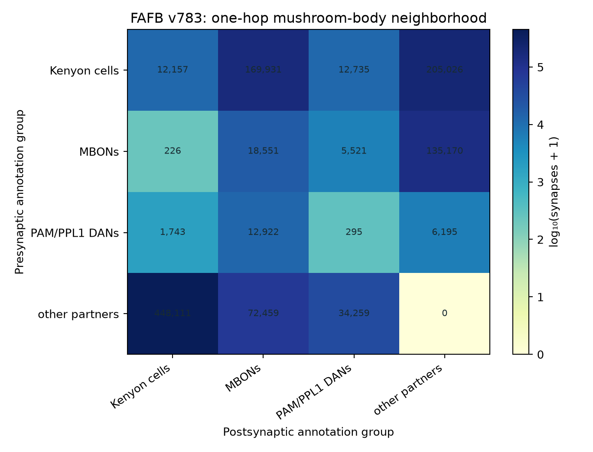
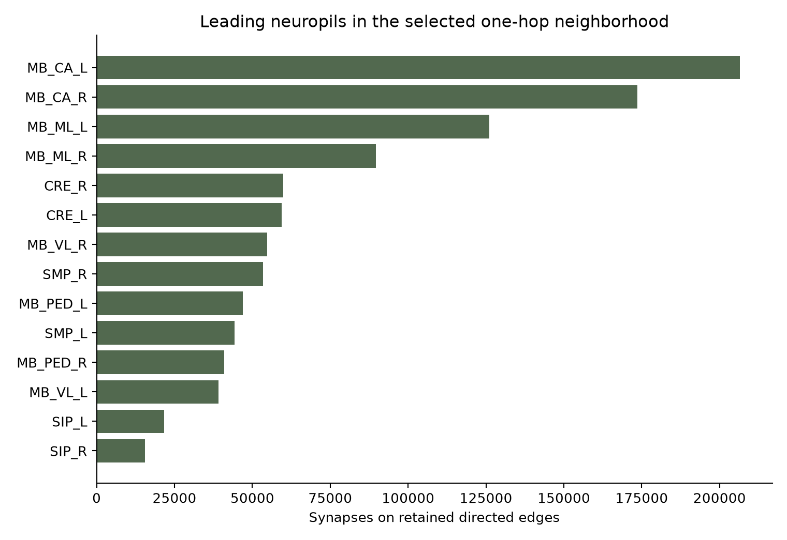

This chapter analyzes the **real adult female FlyWire v783 connectome**. These measured edges are separate from the synthetic memory-learning experiments: synapse counts describe anatomy, not learned weights or neural activity.

## FAFB v783 mushroom-body neighborhood

We joined the proofread directed connection table to the companion neuron annotations. Seed classes include **5,177 Kenyon cells**, **96 mushroom-body output neurons (MBONs)**, and **323 PAM/PPL1 dopamine-neuron annotations**. We retained directed neuron pairs with at least **5 synapses summed across neuropils**, then included their one-hop partners. The resulting local neighborhood contains **81,646 directed neuron pairs** in **178,100 connection-by-neuropil rows**.



The retained graph contains **169,931 synapses from Kenyon cells to MBONs across 21,438 neuron pairs** and **12,922 from PAM/PPL1 neurons to MBONs across 732 pairs**. The largest aggregate is from other partners into Kenyon cells. “Other partners” includes all adjacent neurons outside the three selected seed groups; it is not a cell type.

```{code-cell} python
from pathlib import Path
import pandas as pd
from IPython.display import display

book_dir = next(path for path in (Path.cwd(), Path.cwd().parent) if (path / "assets/flywire-v783/role_connectivity.csv").exists())
flywire_assets = book_dir / "assets/flywire-v783"
role_connectivity = pd.read_csv(flywire_assets / "role_connectivity.csv")
display(role_connectivity.sort_values("synapses", ascending=False).reset_index(drop=True))
```



Download the [top annotated cell-type pairs](assets/flywire-v783/strongest_cell_type_pairs.csv) or [analysis manifest](assets/flywire-v783/analysis_manifest.json), which records the release, threshold, summary counts, and input hashes.

## Reproduce the public-data analysis

The full one-hop table remains local; only aggregated, attributed summaries and figures are published here. The public source requires no Codex token:

```bash
python -m research.download_flywire_v783 --output research/data/raw/fafb-v783-public
python -m research.analyze_flywire_v783
```

The downloader retrieves the **852 MB** proofread connection file from Zenodo and the pinned systematic annotations TSV from the FlyWire annotation repository. It verifies Zenodo’s MD5 checksum and records SHA-256 input hashes. Analysis reads only the required Feather columns and saves raw-neighborhood results to the ignored `research/data/processed/` directory. `pyarrow` is installed with the research requirements.

The 5-synapse threshold follows FlyWire FAFB’s default connection cutoff. Counts are summed across neuropils per ordered neuron pair for thresholding; region-specific rows for qualifying pairs are retained afterward. No direction is reversed, and no synapse count is interpreted as synaptic efficacy.

## Interpretation and limitations

The data support statements about annotated cells and reconstructed structural connectivity in this particular v783 snapshot. They do not show which connections are active during behavior, whether a synapse is excitatory or inhibitory in a given context, or where an individual fly’s memory is stored. The selection of Kenyon cells, MBONs, and PAM/PPL1 annotations is an exploration frame, not a complete functional circuit. No real FlyWire edge from this analysis is used by the synthetic acquisition/extinction/reversal model.

## Sources and attribution

- FlyWire Consortium, [whole-brain connectome connectivity release v783](https://doi.org/10.5281/zenodo.10676866), CC BY 4.0.
- Schlegel et al., [whole-brain annotation and multi-connectome cell typing](https://doi.org/10.1038/s41586-024-07686-5); [pinned annotation release source](https://github.com/flyconnectome/flywire_annotations/tree/a83b2776d60d5764cef36b927f5f9679c16c47a2/supplemental_files).
- Dorkenwald et al., [*A neuronal wiring diagram of an adult brain*](https://doi.org/10.1038/s41586-024-07558-y).
